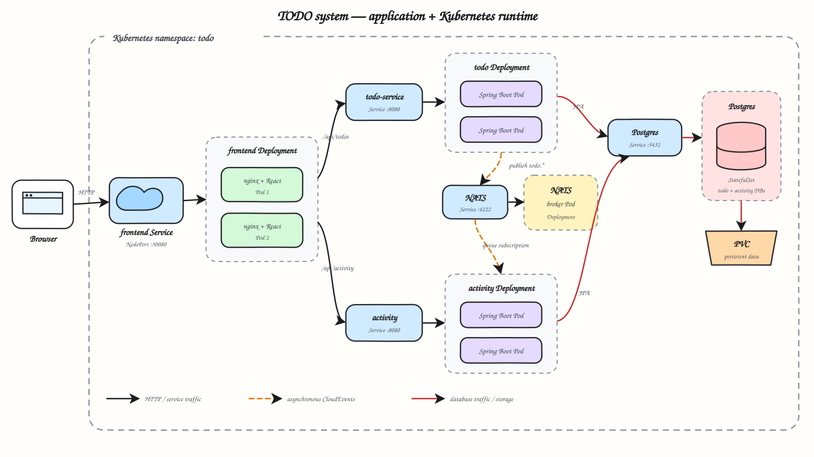

# HSE Winter 2026 — cloud-native lecture application

This repository uses one small distributed TODO system throughout the course. Each lecture adds another layer:
first container images and local orchestration, then Kubernetes deployment and application operations. The same
system can later support CI/CD, resilience and observability exercises.



## Application at a glance

| Component | Responsibility |
|---|---|
| `frontend` | React UI served by nginx; routes browser API requests |
| `todo-service` | Stores and serves tasks; publishes task-change events |
| `activity-service` | Consumes events and builds the activity feed |
| `NATS` | Asynchronous message broker between the two application services |
| `Postgres` | Persistent `todo` and `activity` databases |

The synchronous path is browser → frontend → application service → Postgres. The asynchronous path is
todo-service → NATS → activity-service. See [the architecture notes](docs/architecture.md) for event contracts,
course hooks and deliberate discussion points.

## Lecture summaries

### Lecture 04 — Containers

Build the services into secure, repeatable container images and assemble the system locally.

- Compare a naive Dockerfile with cached multi-stage builds.
- Connect containers through Docker DNS and user-defined networks.
- See the difference between container filesystems, bind mounts and named volumes.
- Replace long `docker run` commands with Docker Compose.
- Scale a stateless service and identify what Compose does not manage.

Start here: [Containers student guide](todo-system/scripts/04-containers/README.md)

### Lecture 07 — Kubernetes

Move the same images into a declarative, self-healing application platform.

- Progress from a bare Pod to Deployments and stable Services.
- Separate runtime configuration and credentials from images.
- Run Postgres with a StatefulSet and persistent volume claim.
- Deploy the complete system through component-owned Kustomizations.
- Scale replicas, observe self-healing, perform rolling updates and roll back.

Start here: [Kubernetes student guide](todo-system/scripts/07-kubernetes/README.md)

## Repository map

```text
.
├── README.md                         # course and lecture index
├── docs/
│   ├── architecture.md               # system design and teaching hooks
│   ├── diagrams/                     # rendered architecture visuals
│   └── student-projects.md
└── todo-system/
    ├── README.md                     # application reference and quick start
    ├── compose.yaml                  # complete Docker deployment
    ├── kustomization.yaml            # complete Kubernetes deployment
    ├── services/<service>/           # source, Dockerfile and owned k8s resources
    ├── infra/                        # Postgres and NATS infrastructure
    └── scripts/<lecture>/            # optional step-by-step lecture demos
```

## Quick start

To run the complete application with Docker:

```bash
cd todo-system
docker compose up -d --build --wait
```

Then open http://localhost:8080. For Kubernetes, follow the preparation and incremental exercises in the
[Kubernetes lecture guide](todo-system/scripts/07-kubernetes/README.md).

