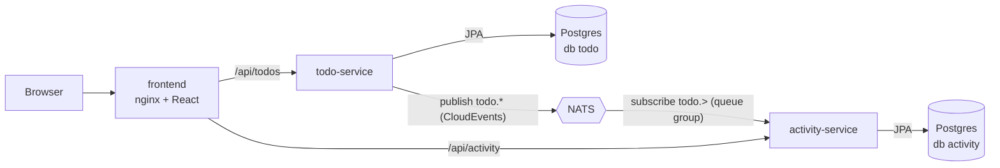

# Architecture

## Components and flows



- **Sync path:** browser → nginx → todo-service (REST). nginx routes by path prefix.
- **Async path:** todo-service publishes after commit; activity-service consumes in a queue group, so N replicas share the stream.
- **Networks (compose):** `frontend` (nginx, services) and `backend` (services, Postgres, NATS). nginx cannot reach the database.

## Event contract

CloudEvents 1.0, structured JSON. NATS subject = `type`.

```json
{
  "specversion": "1.0",
  "id": "c7f1…",
  "source": "/todo-service/<hostname>",
  "type": "todo.completed",
  "time": "2026-10-29T10:00:00Z",
  "datacontenttype": "application/json",
  "data": { "todoId": "…", "title": "Write slides", "done": true }
}
```

Types: `todo.created`, `todo.renamed`, `todo.completed`, `todo.reopened`, `todo.deleted`.

## Built-in hooks per lecture

| Lecture | Hook in the app |
|---|---|
| 04 Containers | multi-stage Dockerfiles, naive counterpart, non-root, exec-form PID 1, compose networks/volumes/limits |
| 07 Kubernetes | liveness/readiness endpoints, graceful shutdown, stateless services, `X-Served-By` for scaling and rolling updates, all config via env |
| CI/CD | per-service Gradle/npm builds with unit tests, OCI labels, `APP_VERSION` build arg |
| 06 Resilience | `CHAOS_FAILURE_RATE`, `CHAOS_LATENCY_MS`; probes unaffected (partial failure) |
| Observability | `/actuator/prometheus`, ECS JSON logs (`json` profile), event ids for correlation |

## Deliberate weaknesses (discussion material, do not "fix" silently)

| Weakness | Why it matters | Typical fix |
|---|---|---|
| Publish after commit (dual write) | crash between commit and publish loses the event | transactional outbox, CDC |
| Core NATS = at-most-once | activity-service down → events lost | NATS JetStream (durable consumer) |
| Event contract duplicated in two services | silent drift | shared schema, AsyncAPI, contract tests |
| No authentication | anyone can write | OIDC (e.g. Keycloak) at the edge |
| One Postgres server for both databases | shared failure domain | separate instances / operator-managed clusters |
| No trace propagation across NATS | traces break at the broker | OpenTelemetry with context in message headers |
