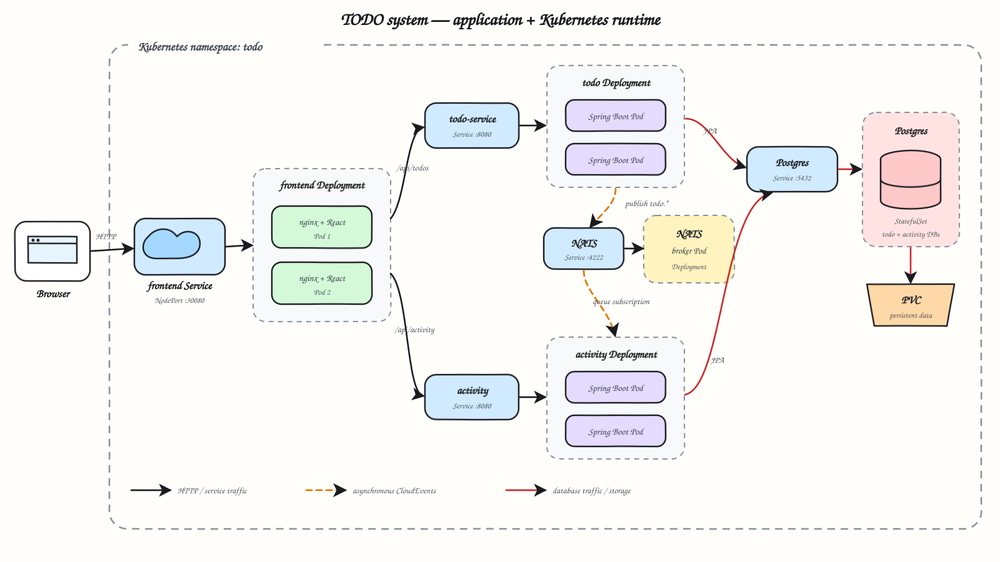

# TODO system — lecture demo application

A small but real distributed system used as the running example across the course
(containers → Kubernetes → CI/CD → resilience → observability) and as the base for student projects.



```
browser ──► frontend (nginx + React) ──► todo-service ──► Postgres (db: todo)
                    │                         │
                    │                         └─ publishes CloudEvents ──► NATS ──► activity-service ──► Postgres (db: activity)
                    └──────────────────────────────────────────────────────────────────────┘ (reads feed)
```

| Component | Tech | Purpose in the course |
|---|---|---|
| `services/frontend` | React 19 + Vite, served by unprivileged nginx | static build, reverse proxy, runtime config via env |
| `services/todo-service` | Spring Boot 4.1, Java 21, Gradle (Kotlin DSL), JPA, Flyway | REST API, stateless, scalable, fault injection |
| `services/activity-service` | Spring Boot 4.1, NATS queue-group consumer | async messaging, idempotent consumer, competing consumers |
| Postgres 17 | one server, one database per service | state, volumes, StatefulSet later |
| NATS 2.11 (core) | pub/sub | event-driven communication |

Details: [architecture notes](../docs/architecture.md). Student projects: [project ideas](../docs/student-projects.md).

## Quick start

Requires Docker with the Compose v2 and buildx plugins (BuildKit). No local JDK or Node needed.

```bash
docker compose up -d --build --wait
open http://localhost:8080      # UI
open http://localhost:8222      # NATS monitoring
```

Find a service's ephemeral host port: `docker compose port todo-service 8080`.

**Colima / plain Docker CLI on macOS**

- `brew install docker docker-compose docker-buildx colima`, register the plugins
  (`"cliPluginsExtraDirs": ["/opt/homebrew/lib/docker/cli-plugins"]` in `~/.docker/config.json`).
- Give the VM enough memory: `colima start --cpu 4 --memory 8`. The default (2 GiB) is too small for
  parallel Gradle builds plus two JVMs; builds then die with exit 137.
- Keep the repo under `$HOME`: Colima only mounts the home directory into the VM, and Compose bind-mounts `infra/`.

## Maintainer: generated files

`./scripts/bootstrap.sh` regenerates the Gradle wrappers and `package-lock.json` (in containers). Run it after
changing Gradle or npm dependencies and commit the result. Students never need it.

## API

| Method | Path | Notes |
|---|---|---|
| GET | `/api/todos` | newest first |
| POST | `/api/todos` | `{"title": "..."}` → 201 |
| GET / PATCH / DELETE | `/api/todos/{id}` | PATCH: `{"title"?, "done"?}` |
| GET | `/api/activity` | latest 50 events |
| GET | `/actuator/health/{liveness,readiness}`, `/actuator/prometheus` | per service, not routed via nginx |

Every API response carries `X-Served-By` (container/pod name) and `X-App-Version`.

## Configuration (env vars)

| Variable | Service | Default |
|---|---|---|
| `DB_URL`, `DB_USER`, `DB_PASSWORD` | todo, activity | localhost Postgres |
| `NATS_URL` | todo, activity | `nats://localhost:4222` |
| `APP_VERSION` | all | `dev` (build arg + env) |
| `PORT` | todo, activity | 8081 / 8082 locally, 8080 in containers |
| `CHAOS_FAILURE_RATE` (0–1), `CHAOS_LATENCY_MS` | todo | 0 |
| `SPRING_PROFILES_ACTIVE=json` | todo, activity | plain logs; `json` = ECS structured logs |
| `TODO_SERVICE_URL`, `ACTIVITY_SERVICE_URL` | frontend | compose service names |
| `NGINX_RESOLVER` | frontend | `127.0.0.11` (Docker DNS) |

## Inner loop (no image builds)

Needs a local JDK 21+ and Node 24 (`npm ci` once in `services/frontend`).

```bash
docker compose up -d --wait postgres nats
(cd services/todo-service && ./gradlew bootRun)       # :8081
(cd services/activity-service && ./gradlew bootRun)   # :8082
(cd services/frontend && npm run dev)                 # :5173, proxies /api to 8081/8082
```

## Kubernetes deployment

Kubernetes resources are owned by the component they deploy:

- `services/<service>/k8s/` contains that service's Deployment and Service,
- `infra/postgres/k8s/` contains database configuration, storage and networking,
- `infra/nats/k8s/` contains the NATS message broker Deployment and Service,
- the root `kustomization.yaml` composes the complete application.

After preparing a cluster and making the images available to it, deploy from this directory:

```bash
kubectl apply -k .
kubectl -n todo get all
```

NATS is the internal event bus: todo-service publishes task changes and activity-service consumes them to build
the activity feed. It lives under `infra/` because it is a third-party runtime dependency, like Postgres.

## Demos

- [scripts/04-containers](scripts/04-containers/README.md) — lecture 04 Containers: images, networks, volumes and Compose
- [scripts/07-kubernetes](scripts/07-kubernetes/README.md) — lecture 07 Kubernetes: Pods, Deployments, Services, configuration, persistent state, scaling and rollouts

## Status and known gaps

Written without network access: **nothing here has been built or run yet.** Before the first lecture:

1. `./scripts/bootstrap.sh`, commit, then `docker compose up --build --wait`, then `AUTO=1` through each demo script.
2. Verify these assumptions (most likely failure points first):
   - Spring Boot **4.1.1** Gradle plugin with Gradle 9.4 and `io.spring.dependency-management` 1.1.7.
   - Boot 4 auto-configures a Jackson 3 `tools.jackson.databind.json.JsonMapper` bean (injected in both services).
   - `io.nats:jnats:2.20.5` exists and has `Nats.connectReconnectOnConnect(Options)` (activity-service) and `Nats.connect(Options)`; bump if a newer version is current.
   - todo-service starts without NATS (`NatsClient`, background connect); activity-service still blocks until NATS is reachable.
   - `nginxinc/nginx-unprivileged` renders `NGINX_RESOLVER` into `resolver` (frontend starts before its backends).
   - `/actuator/prometheus` is exposed with `spring-boot-starter-actuator` + `micrometer-registry-prometheus` under Boot 4 modularisation.
   - Image tags: `nginxinc/nginx-unprivileged:1.28-alpine`, `nats:2.11-alpine`, `registry:3`, `node:24-alpine`.
3. Pin base images by digest once verified (see demo 20: tags move).
